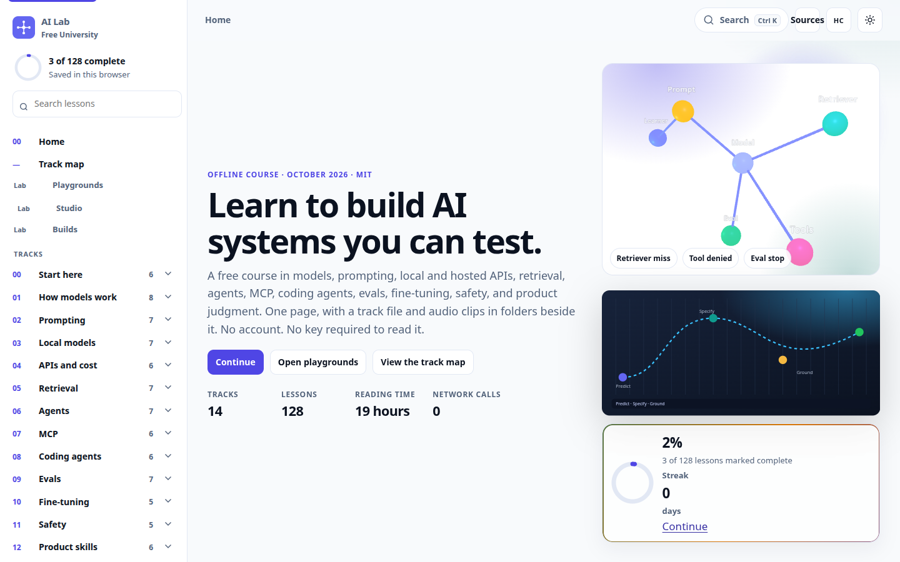
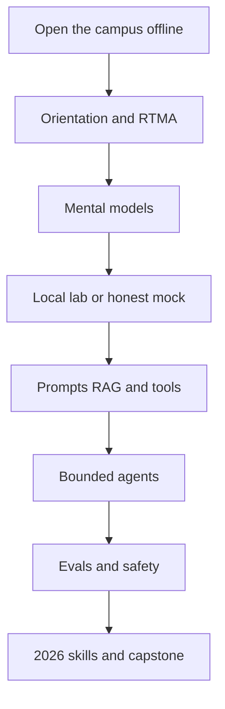

<p align="center">
  <a href="./downloads/ai-lab-university.html.zip"></a>
  <a href="./campus/ai-lab-university.html"></a>
  <a href="./LICENSE"></a>
</p>

<h1 align="center">🧠 AI Lab Free University</h1>

<p align="center">
  <strong>A free offline campus for people learning AI by doing the work.</strong><br/>
  One HTML file · local and hosted models · agents · evals · RTMA proof · no account
</p>

<p align="center">
  
  
  
  
</p>

<p align="center">
  <a href="https://github.com/cipher0x9/uc-lab-free-university-mesmerizing"></a>
  
  
</p>

<p align="center">
  
</p>

## Contents

- [What this is](#what-this-is)
- [Quick start](#quick-start)
- [What's inside](#whats-inside)
- [Who it's for](#who-its-for)
- [Learning path](#learning-path)
- [Section map](#section-map)
- [Labs](#labs)
- [Safety](#safety)
- [License](#license)
- [Contribute](#contribute)

## What this is

This is a single HTML campus you can open from disk. It is for a student meeting AI for the first time, a career-changer building proof, an engineer adding agents to a real system, a teacher who needs a class with no accounts, and a domain expert who already knows the work and wants the mechanism.

Country, credential, hardware budget, and vendor are not admission requirements. Read with zero keys. Add a local model or a hosted API only when an experiment needs one.

> [!NOTE]
> The campus has **259 sections**. An older public description said 431 lessons, 1,056 links, nine themes, and an export center. That build was retired and is not in this repository. Believe the file you open.

> [!TIP]
> New here? Read [docs/HOW-TO-USE.md](./docs/HOW-TO-USE.md). It covers every file, a 30-day path, interview prep, and how to teach a class. Builders should read [docs/REMIX.md](./docs/REMIX.md).

## Quick start

### Download

1. Download [downloads/ai-lab-university.html.zip](./downloads/ai-lab-university.html.zip).
2. Unzip it.
3. Open **`ai-lab-university.html`** in Chrome, Safari, Edge, or Firefox.

The full browser app matters. In-app browsers (chat, mail, social) often refuse a local HTML file.

| Device | What to do |
|---|---|
| Laptop or desktop | Best. Unzip, then double-click the HTML file. |
| Android phone | Download, then open the file in the full Chrome app. |
| iPhone | Download → Files → share or open in Chrome or Safari. The first open can take a few seconds. |

> [!WARNING]
> Do not open the campus inside an in-app web view. Use the full browser. No account and no API key are required to read it.

### Clone

```bash
git clone https://github.com/cipher0x9/ai-lab-free-university-mesmerizing.git
cd ai-lab-free-university-mesmerizing
python3 labs/01-local-hello.py
```

On macOS you can also `open campus/ai-lab-university.html`. On Linux, `xdg-open campus/ai-lab-university.html`.

A smaller starter, if the full campus feels like too much on night one: [downloads/golden-slice.html.zip](./downloads/golden-slice.html.zip).

More ways in: [docs/HOW-TO-GET.md](./docs/HOW-TO-GET.md) · [docs/START-HERE.md](./docs/START-HERE.md) · [docs/DOWNLOADS.md](./docs/DOWNLOADS.md) · [docs/FAQ.md](./docs/FAQ.md)

## What's inside

| File | What it is | How to use it |
|---|---|---|
| [campus/ai-lab-university.html](./campus/ai-lab-university.html) | The campus. 259 sections, 17 schools, search, themes, study ticks saved in the browser. | Open it. No server and no CDN. |
| [campus/golden-slice.html](./campus/golden-slice.html) | Phase-1 slice: RTMA, the school map, labs 01–03, a GREEN checklist. | Open it when you want the short path first. |
| [downloads/ai-lab-university.html.zip](./downloads/ai-lab-university.html.zip) | Zip of the campus HTML only. | Download, unzip, open the HTML. |
| [downloads/golden-slice.html.zip](./downloads/golden-slice.html.zip) | Zip of the golden slice. | Same, for the short path. |
| [docs/HOW-TO-USE.md](./docs/HOW-TO-USE.md) | Learner guide: files, mobile, 30 days, interviews, teaching. | Read before you plan a month or a class. |
| [docs/HOW-TO-GET.md](./docs/HOW-TO-GET.md) | Download and open steps, including phones. | Send this to someone who only wants the file. |
| [docs/START-HERE.md](./docs/START-HERE.md) | Audience, paths, and the safety bar. | Read once, then enter the HTML. |
| [docs/DOWNLOADS.md](./docs/DOWNLOADS.md) | The same files, listed as a download sheet. | Use when you are choosing zip vs clone. |
| [docs/FAQ.md](./docs/FAQ.md) | Short answers: keys, PDF, certificates, siblings. | Check before you file an issue. |
| [docs/SIBLINGS.md](./docs/SIBLINGS.md) | How this campus sits next to UC Lab. | Open when you also work in voice or contact center. |
| [docs/REMIX.md](./docs/REMIX.md) | How lessons, themes, and zips are built. | Read before you add a lesson or a theme. |
| [docs/assets/preview.png](./docs/assets/preview.png) | Static preview of the campus. | Used by this README. |
| [labs/README.md](./labs/README.md) | Six zero-key Python labs and where artifacts go. | Run from the repo root. |
| [labs/evals/golden10.json](./labs/evals/golden10.json) | The 10-question fixture lab 03 scores. | Edit the questions, keep the threshold honest. |
| [scripts/verify_campus.py](./scripts/verify_campus.py) | Checks the count, offline rule, privacy sweep, labs, and zips. | `python3 scripts/verify_campus.py` |
| [scripts/rebuild_zips.py](./scripts/rebuild_zips.py) | Rewrites `downloads/*.zip` from `campus/`. | Run after every HTML edit. |
| [scripts/verify_slice.sh](./scripts/verify_slice.sh) | Older name for the same checker. Lessons still mention it. | `bash scripts/verify_slice.sh` |
| [CONTRIBUTING.md](./CONTRIBUTING.md) | Review rules for issues and pull requests. | Read before you open a PR. |
| [LICENSE](./LICENSE) | MIT. | Keep the notice if you share a copy. |
| [NOTICE.md](./NOTICE.md) | Educational clarifications. | Read before you treat a lesson as production advice. |
| [CITATION.cff](./CITATION.cff) | Citation metadata. | Use it if you cite the campus. |

<details>
<summary>🧪 RTMA, the proof habit</summary>

| Letter | Meaning | You keep |
|:--:|---|---|
| **R** | **Run** — did it execute? | The command, cell, or agent task |
| **T** | **Trace** — what path did it follow? | Steps, tool calls, approvals, errors |
| **M** | **Metric** — what was measured? | Quality, latency, cost, pass rate |
| **A** | **Artifact** — what can someone reopen? | The file left behind on purpose |

The voice sibling uses **LICC** (Leg · ID · Counter · Capture). Same habit, different domain.

</details>

## Who it's for

You belong here if you are a student, a career-changer, an engineer, a founder, a teacher, a creator, a researcher, or a domain expert. No prior AI job is required.

| You want to… | Start |
|---|---|
| Learn the mechanism without a cloud bill | Golden slice, then school 02, then lab 01 |
| Change careers and show proof | School IV (interview bank) and [the 30-day path](./docs/HOW-TO-USE.md#a-30-day-study-path) |
| Add agents to software you already ship | Schools 06 and 08, plus lab 07 |
| Teach a class with no accounts | [Teaching a class](./docs/HOW-TO-USE.md#teach-a-class) |
| Bring a non-software domain | Path B inside the campus, then school 11 |
| Practice 2026 job skills | School **11 · 2026 skills** (MCP, coding agents, evals, portfolio proof) |

Use cases that fit this repo: offline study, a laptop lab, interview drills, a one-hour lunch-and-learn, and a remix you host yourself. It is not a hosted classroom, a certificate, or a support contract.

## Learning path



Color themes in the campus: Night, Cobalt, Aurora, Slate, Warm, Forest, and Paper. **Focus** is a layout button that hides the sidebar. Study ticks stay in this browser only.

## Section map

<details>
<summary>🗺️ 17 schools · 259 sections</summary>

| ID | School | Sections | Job |
|---|---|---:|---|
| 00 | Orientation | 17 | Map, honesty, safety, hardware |
| 01 | Mental models | 17 | Tokens, context, failure modes |
| 02 | Local lab | 17 | Runners, catalogs, a first model |
| 03 | Cloud APIs | 16 | Keys, limits, cost, structured output |
| 04 | Prompt systems | 13 | Contracts and eval-driven prompts |
| 05 | RAG | 13 | Chunks, citations, when not to retrieve |
| 06 | Agents and tools | 16 | Loops, schemas, permissions |
| 07 | Voice AI bridge | 12 | Latency, STT, TTS, human handoff |
| 08 | Evals and safety | 16 | Golden sets, red team, incidents |
| 09 | Ship and share | 13 | Small packs, licenses, what never to publish |
| 10 | Capstone | 7 | A domain coach with citations |
| 11 | 2026 skills | 12 | Hiring signals, MCP, coding agents |
| RT | RTMA handbook | 10 | The evidence grammar |
| GL | Glossary | 36 | Plain definitions |
| PX | Paths | 10 | Where to start by audience |
| IV | Interview bank | 14 | 30-second and 90-second answers |
| FQ | FAQ | 20 | Honest limits |

School 03 skips id `03-16` on purpose. The count is 16 sections. Do not renumber old anchors.

</details>

## Labs

From a clone, at the repository root:

```bash
python3 labs/01-local-hello.py
python3 labs/02-tool-call.py
python3 labs/03-golden-eval.py
bash scripts/verify_slice.sh
```

Lab 01 prints `backend=mock` when nothing is listening on port 11434. That is a successful honest run. Details: [labs/README.md](./labs/README.md).

## Safety

> [!IMPORTANT]
> Educational material only. No warranty. Pin official vendor documentation before any production change. Never commit API keys, customer data, private chats, or model weights. No autonomous email, post, or payment without a human.

The sibling campus for voice and contact center is [UC Lab Free University](https://github.com/cipher0x9/uc-lab-free-university-mesmerizing). Its current HTML zip is [v17-UNIVERSITY.html.zip](https://github.com/cipher0x9/uc-lab-free-university-mesmerizing/releases/download/v20.2-resources/v17-UNIVERSITY.html.zip). See [docs/SIBLINGS.md](./docs/SIBLINGS.md).

## License

[MIT](./LICENSE). Copyright (c) 2026 CYPHER0X9. [NOTICE.md](./NOTICE.md) spells out what that does and does not grant. [CITATION.cff](./CITATION.cff) is there if you cite the campus.

## Contribute

Issues and pull requests are welcome. Read [CONTRIBUTING.md](./CONTRIBUTING.md) and [docs/REMIX.md](./docs/REMIX.md). Run `python3 scripts/verify_campus.py` before you push. Regenerated zips belong in the same change as the HTML.

<p align="center">
  <strong>Build calmly · Prove carefully · Share freely</strong><br/>
  <em>CYPHER0X9 · <a href="https://github.com/cipher0x9">github.com/cipher0x9</a></em>
</p>
