<p align="center">
  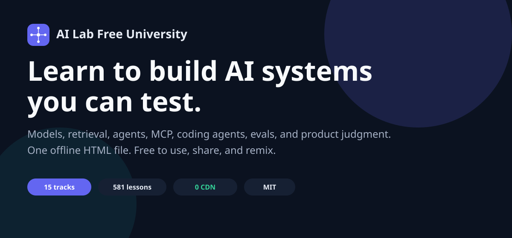
</p>

# AI Lab Free University

A free offline course for people who want to build with models and be able to show their work. It covers how models behave, prompting, local and hosted APIs, retrieval, agents, the Model Context Protocol (MCP), coding agents, evals, fine-tuning, safety, and the product skills behind a shippable feature.

One shell page, with each track loaded when you open it. Audio clips, the service worker, and the 3D scene sit in folders beside that page. No account. No API key required to read it. No remote fonts, scripts, or images.

**Free to use, share and remix.** MIT license for the code. CC BY-NC-SA for the lesson content. No warranty. See [LICENSE](LICENSE).

<p align="center">
  <a href="downloads/ai-lab-university.html.zip"><strong>Download the campus (.zip)</strong></a>
  &nbsp;&nbsp;·&nbsp;&nbsp;
  <a href="https://cyphermonkeylabs.com/ai-lab-free-university-mesmerizing/campus/ai-lab-university.html"><strong>Open the published site</strong></a>
</p>

Direct download from GitHub: [ai-lab-university.html.zip](https://github.com/CypherMonkeyLabs/ai-lab-free-university-mesmerizing/raw/main/downloads/ai-lab-university.html.zip)

---

## What you get

| | |
|---|---|
| Course | `campus/ai-lab-university.html` — 16 tracks, **593 study pages** |
| File | A shell page, track modules in `campus/assets/curriculum/`, audio, and a service worker. Progress stays in your browser. After one visit on that site, the course stays available offline. |
| Labs | `labs/` — zero-key Python. A missing local model is reported as mock. |
| Proof | Every practice asks for a run, a trace, a metric, and an artifact |
| Updated | October 2026. Pin the model id you call; names move. |

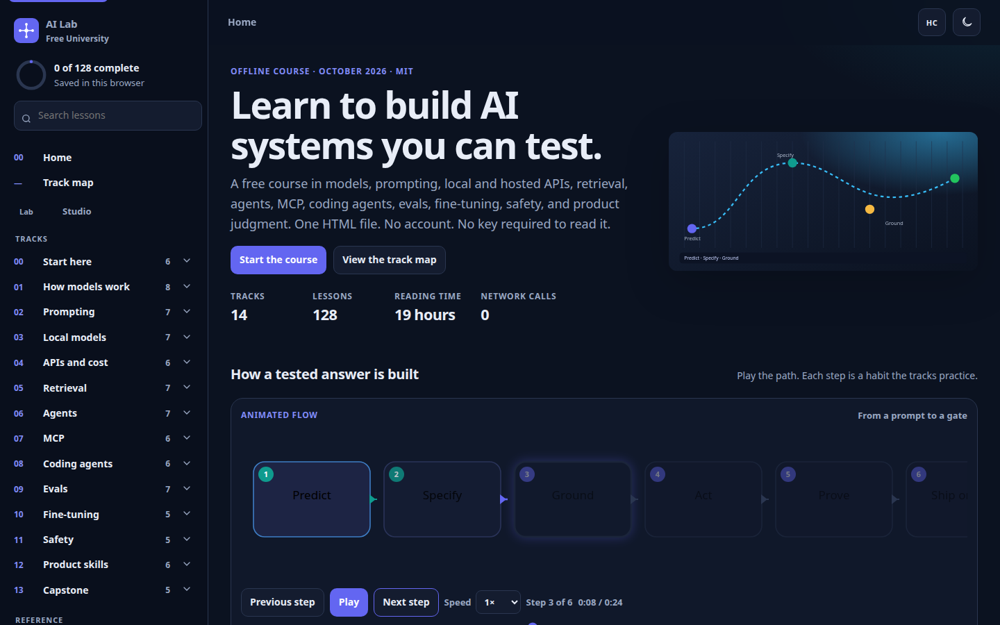

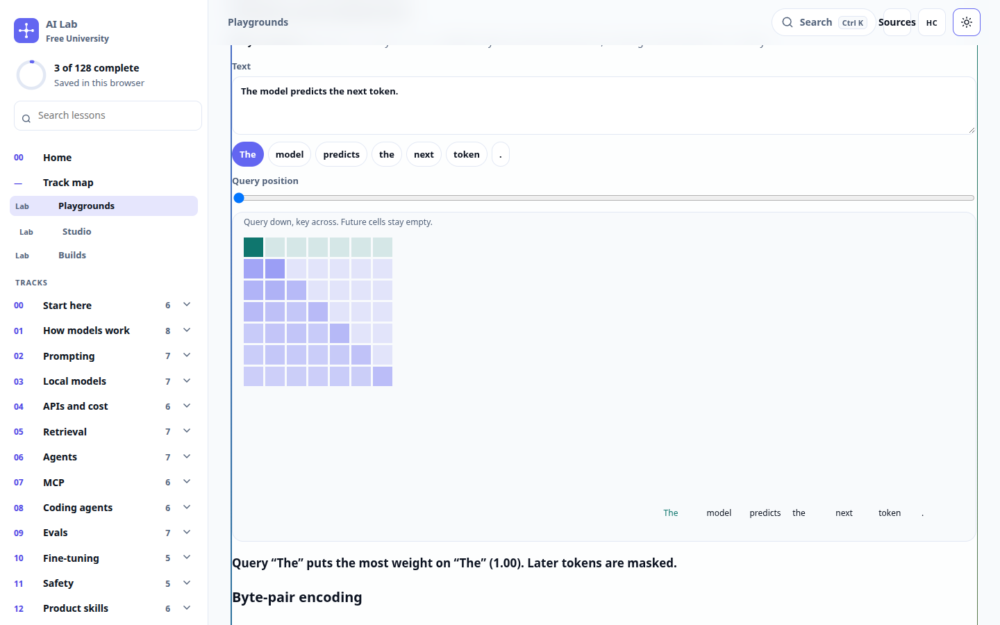

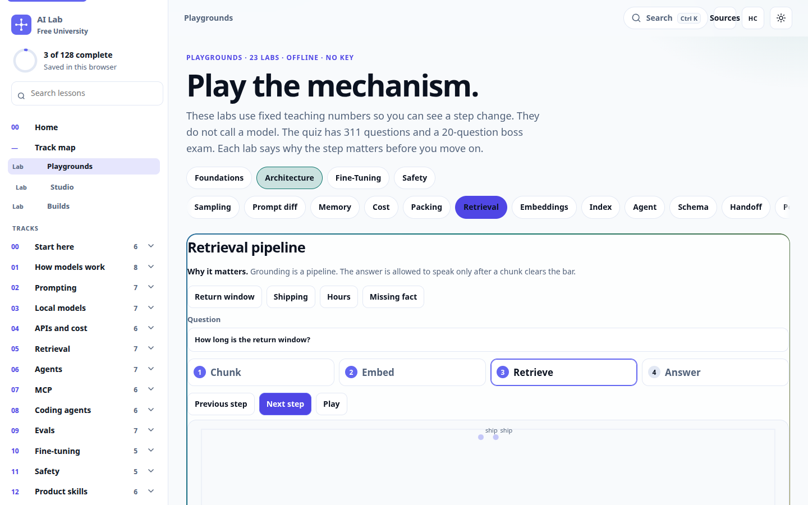

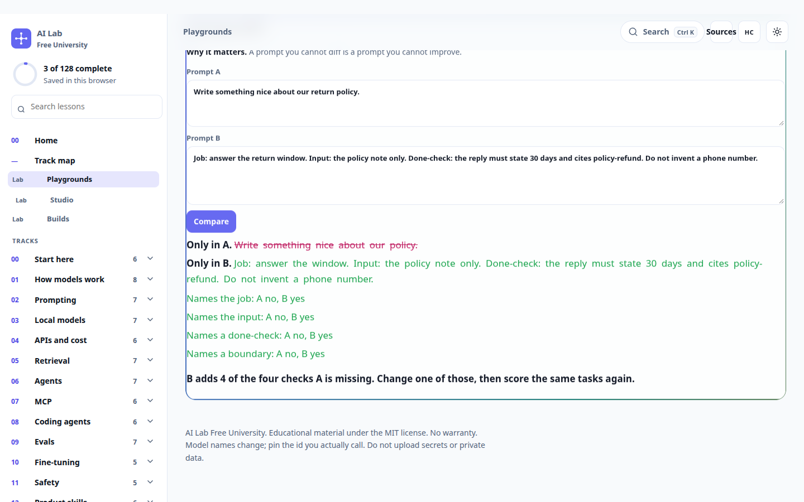

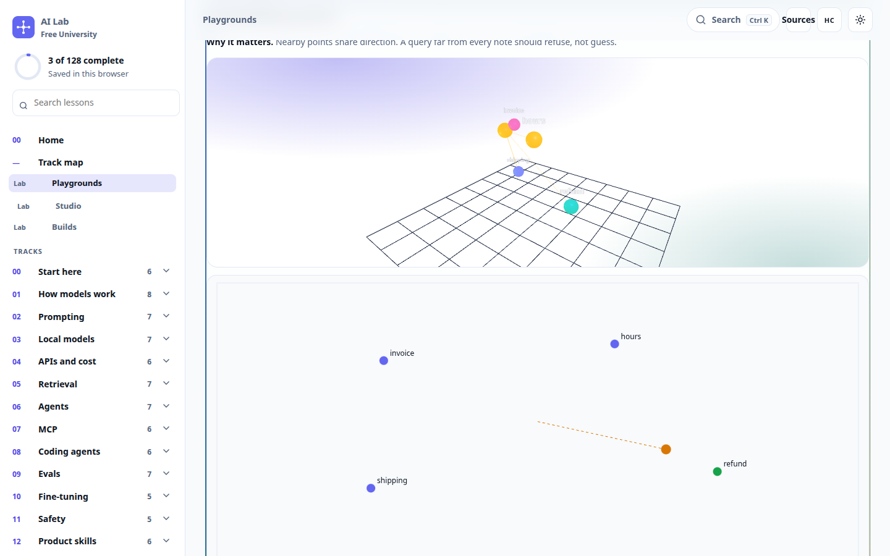

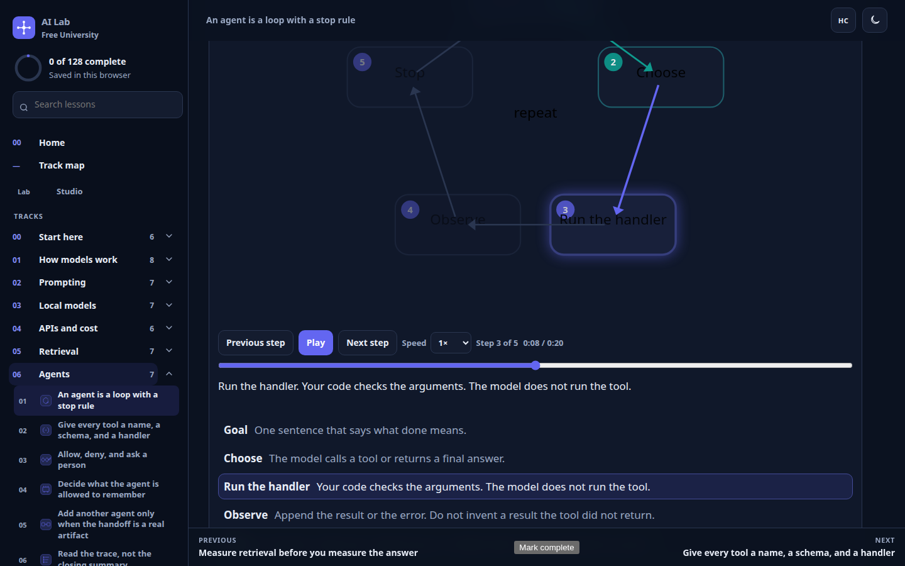

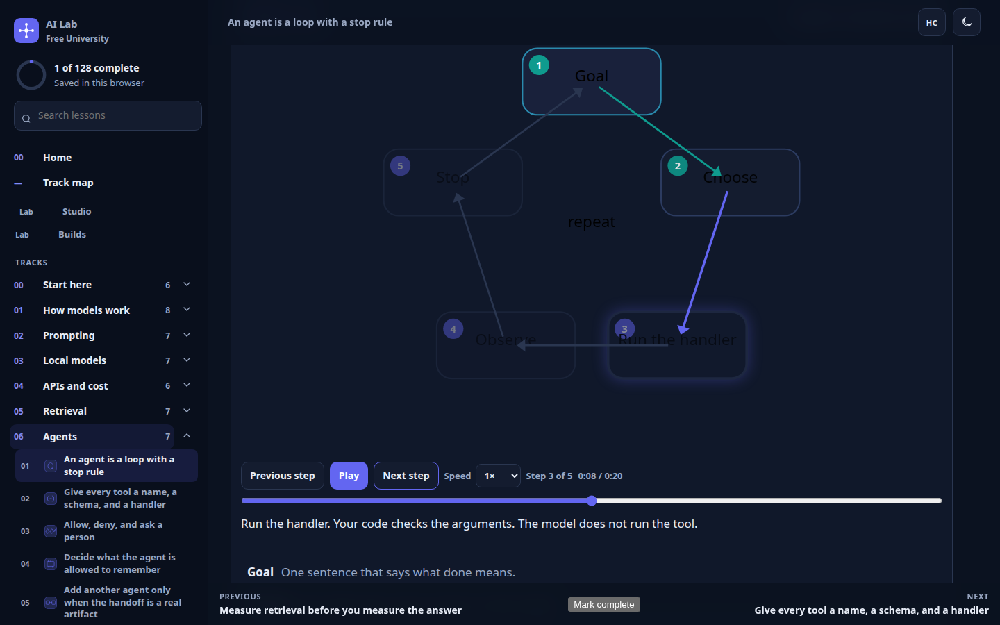

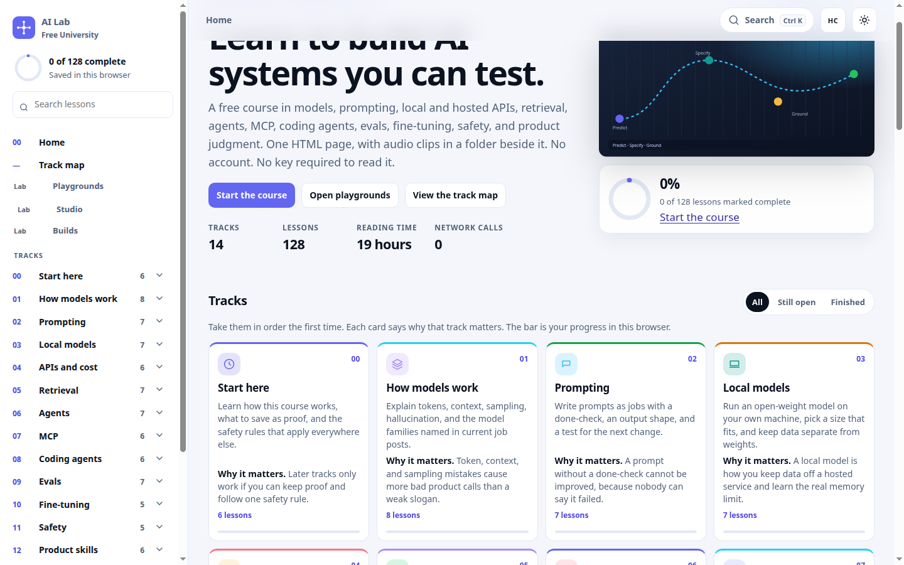

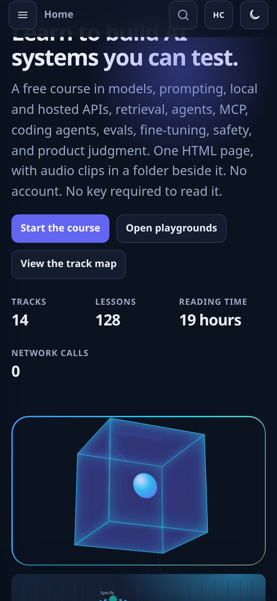

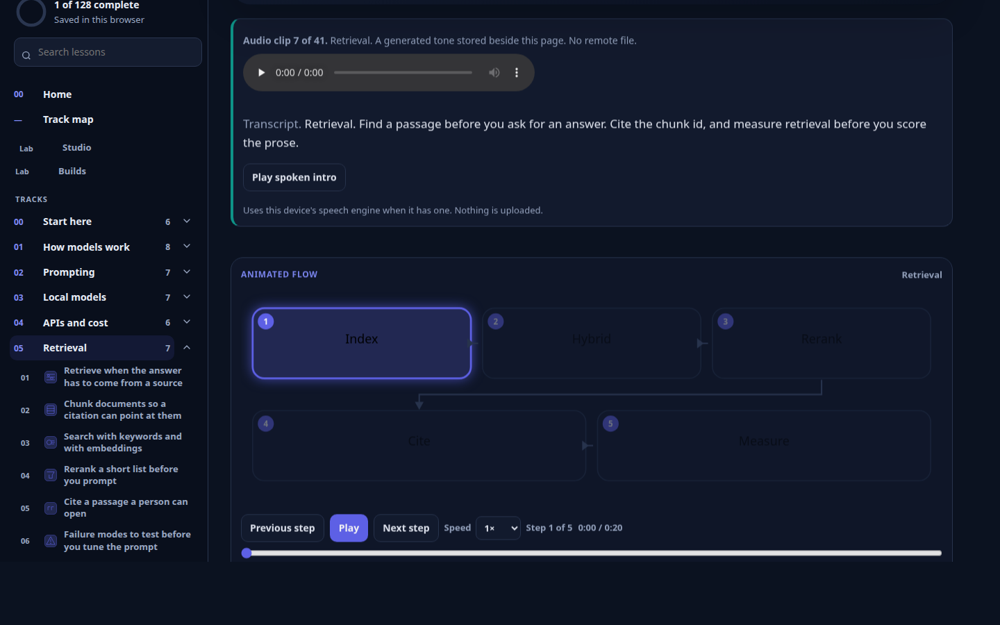

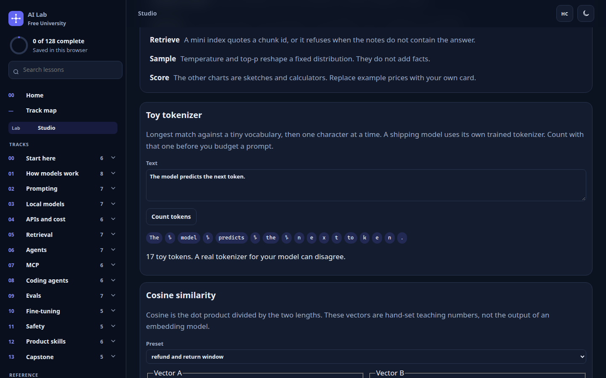

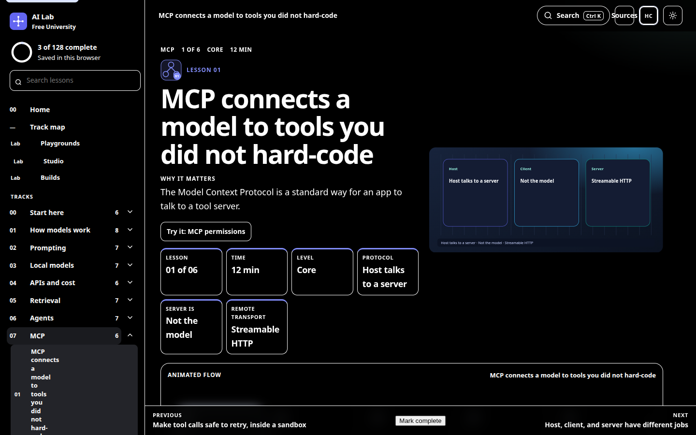

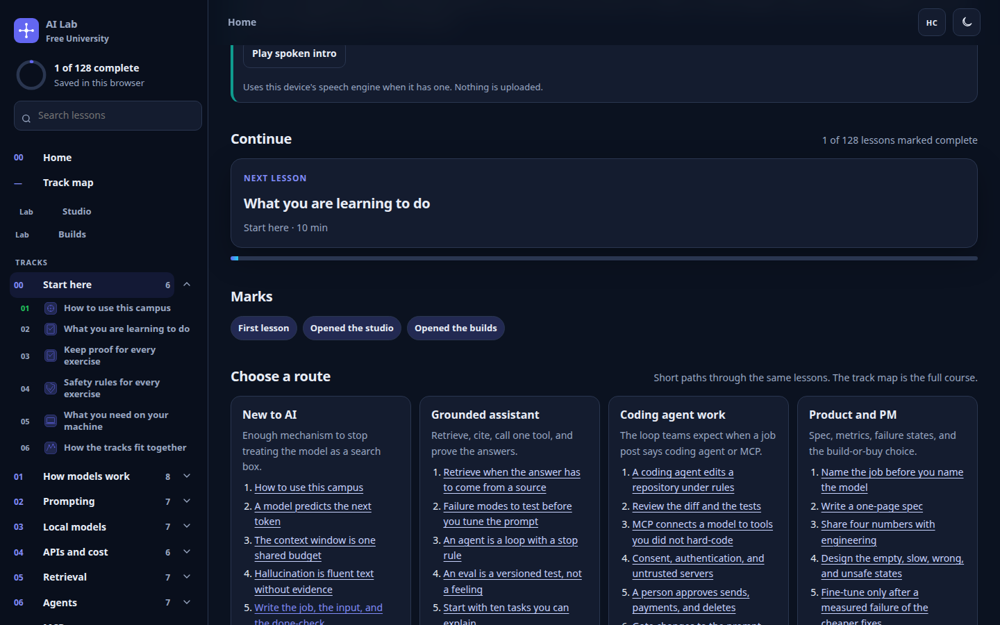

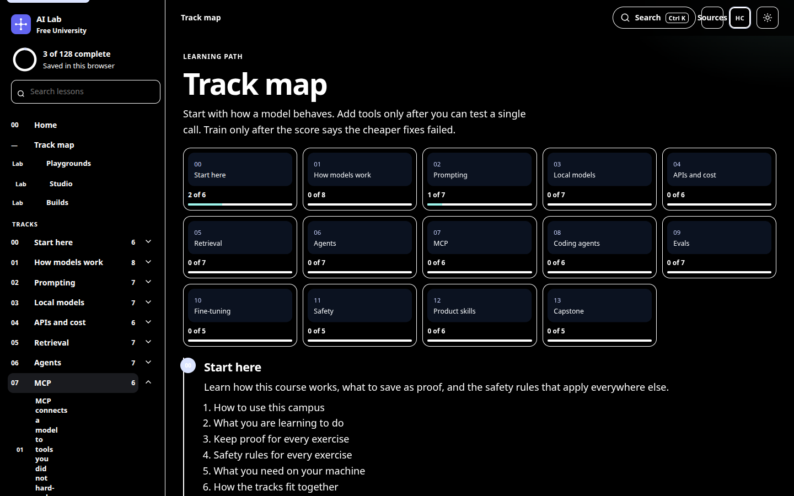

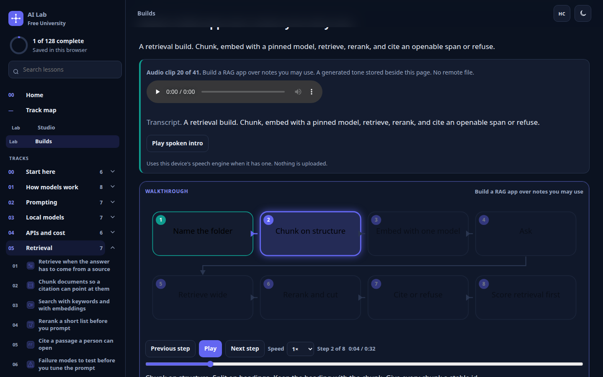

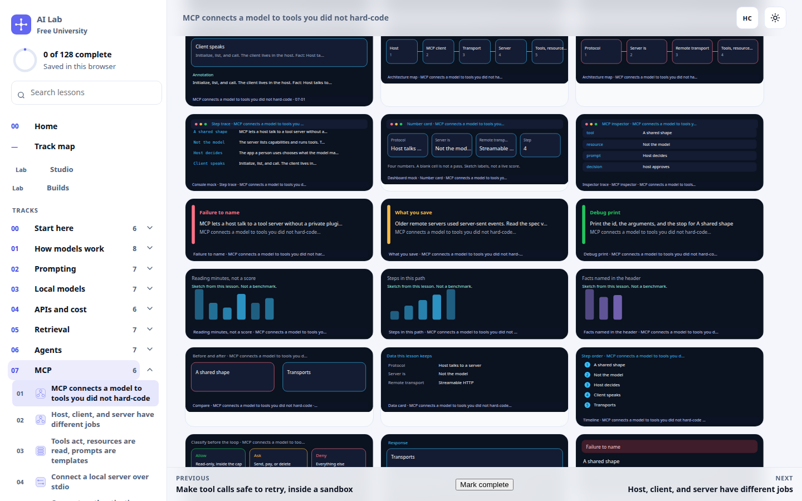

## Pictures in the file

Counted from the built HTML. These are floors the generator enforces, and the current file is above them.

| Asset | Count | What it is |
|---|---:|---|
| Inline SVG elements | 18,584 | Icons, heroes, flows, plates, galleries, the map, and 38 room diagrams from the study draft |
| Distinct SVG drawings | 16,164 | Same markup with a different `data-art` id counts once |
| Distinct `data-art` ids | 18,462 | Every drawing has its own id, including icon clones |
| Animated flows | 1,822 | Three per study page (the path, a failure, and a debug pass), plus track hubs, home, the studio, and 22 build walkthroughs |
| Build walkthroughs | 22 | End-to-end plays: retrieval, an MCP server, an eval harness, an agent, a local model, and the rest of the build list |
| Hero illustrations | 613 | One per study page, one per track hub, and the home poster |
| Diagram plates | 593 | One per study page, under the prose |
| Lesson icons | 593 | Numbered badge in the page header |
| Room diagrams | 38 | Architecture and sequence drawings for the 19 written rooms. A 39th flow was not in the source folder |
| Audio clips | 43 | Home, each track, the reference sections, the studio, and one clip per build. Generated tones in `campus/assets/audio/`, with a transcript |
| Charts | 41 | Course counts, plus labeled sketches. Click a mark to read the value |
| Zero-key demos | 58 | The 41 charts, plus sampling, chunking, reranking, an agent trace, LoRA rank, quantization memory, and eleven smaller checks |
| Lesson widgets | 21 | The original tokenizer, cosine, attention, retrieval, sampling, context, loss, latency, scorecard, and embedding map. Eleven sit on a lesson. All ten also live in the studio |
| Playgrounds | 23 | Hands-on labs, plus a 3,799-question cited quiz, 3,799 flashcards, and 32 boss-exam steps. Fixed numbers. No key |
| Cheat sheets | 8 | HTML, PDF, and SVG for ports, flows, config, troubleshooting, migration, security, evals, and a glossary card |

Every flow has play, pause, previous, next, a speed control, a timeline, a highlighted stage, and a plain-English caption. Toy math is labeled as toy. Example prices are not a quote. Marks and the track-map meters use the same completion ticks already stored in this browser.

## Page weight

The previous course was one 7,733,699-byte page: 151 `h1` elements and about 94,000 DOM nodes, with no WebGL.

The page you open now is a 458,910-byte shell. One view is mounted at a time, so the home screen is 1,086 DOM nodes and a single `h1`. Track lessons, the map, the studio, the builds, and the playgrounds load from `campus/assets/curriculum/` when you open them. Settings, tips, and Three.js load when you open them. After the first visit on that origin, the service worker keeps the files you have used for offline use.

The 3D scene is vendored: `space.js` (12,743 bytes), Three.js (691,648 bytes), and OrbitControls (32,150 bytes). Home keeps the flat map. Three.js loads when you open the 3D campus, or when the embedding lab is on screen. Shell plus that scene is about 1.1 MB, under a 1.5 MB first load.

Lighthouse mobile, simulated throttling, on the shell: **performance 74**, **accessibility 96**, total blocking time 210 ms, cumulative layout shift 0. The same run before lazy 3D scored performance 30 and total blocking time 142,540 ms.

## What you'll learn

| Track | Lessons | You will be able to |
|---|---:|---|
| Start here | 6 | Use the course, keep proof, and apply the safety rules |
| How models work | 10 | Explain tokens, context, sampling, hallucination, and 2026 model roles |
| Prompting | 10 | Write a job, an output shape, and a test for the next change |
| Local models | 7 | Run an open-weight model that fits your machine, and keep data apart from weights |
| APIs and cost | 7 | Call a hosted model without leaking the key, and read the bill |
| Retrieval | 9 | Cite a real passage, and measure whether retrieval found it |
| Agents | 9 | Design a tool loop with a schema, a step cap, and a trace |
| MCP | 6 | Connect a tool server without granting it silent access |
| Coding agents | 6 | Review a repository edit against the diff and the tests |
| Evals | 9 | Gate a change on quality, safety, latency, and cost |
| Fine-tuning | 6 | Decide when LoRA is warranted, and compare it to the base model |
| Safety | 6 | Write a one-page policy for data, tools, and human approval |
| Product skills | 6 | Specify a feature a product manager and an engineer can measure |
| Capstone | 5 | Finish a small grounded assistant on notes you are allowed to use |
| Contact center | 5 | Keep the model beside the queue, the recording, and the person who owns the call |
| Ecosystem | 12 | Map ports, cutovers, CRM bridges, emergency calling, and what this course will not certify |

Glossary (357 entries), interview practice (109 drills), and course questions sit beside the tracks. Reading time for the whole catalog is about 137 hours because the glossary and the drills are included. Eighty-one thin glossary stubs were expanded into short lessons. The 19 long rooms are the deep reads. Vendor model ids inside those rooms were carried from the 2026-10-14 draft and were not re-fetched on 2026-10-15.

## Learning path

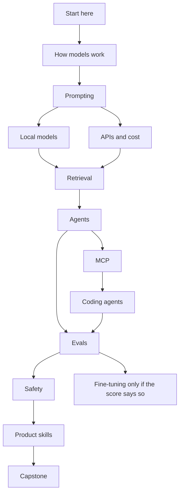

Four shorter routes are on the home page: new to AI, a grounded assistant, coding-agent work, and product judgment.

---

## How to use it

1. Download [ai-lab-university.html.zip](downloads/ai-lab-university.html.zip).
2. Unzip it.
3. From that folder, run `python3 -m http.server 8000` and open `http://127.0.0.1:8000/ai-lab-university.html` in Chrome, Safari, Edge, or Firefox. A `file://` path cannot load the tracks.
4. Or open the [published site](https://cyphermonkeylabs.com/ai-lab-free-university-mesmerizing/campus/ai-lab-university.html) in the full browser app. On a phone, use that site. In-app browsers often block scripts.

Study a lesson, do the practice, then use **Next**. **Mark complete** stores progress only in that browser and keeps a day streak there too. Search is in the sidebar, and **Ctrl+K** (or **Command+K**) opens the command palette. Each lesson opens with three animated flows and a **Try it** link to the playground that matches the lesson. **Playgrounds** groups the 23 labs into Foundations, Architecture, Fine-Tuning, and Safety. The labs include tokens and a byte-pair tokenizer, sampling, a prompt diff, retrieval, a 3D embedding space whose sliders stay in sync with the scene, a vector index, a tool schema, a multi-agent handoff, an MCP JSON-RPC inspector, a guardrail that refuses, an eval gate, LoRA rank, and a prompt-versus-retrieval-versus-fine-tune wizard. **Sources** opens the primary documents (Vaswani 2017, Lewis 2020, Hu 2021, the MCP specification, and the vendor docs). **Tips** opens pro tips, interview traps, and a cheat sheet for the current track. **Settings** stores the theme (dark, light, high contrast, or dusk), sound effects, narration and voice, speed, reduced motion, and font size in this browser. Narration waits for the voice list and does not default to a robotic desktop voice. The quiz has 3,799 questions scored per track, with reasons, and boss-exam steps drawn from the incident set. **Builds** walks through whole projects. **Studio** runs the toy demos and charts with no key. The sun and moon button switches the light and dark themes. **HC** is a separate high-contrast switch. `/` focuses the sidebar search. `[` and `]` move between lessons. A playing clip stays in the bar at the bottom of the page, with a waveform and a caption.

A desktop browser is the most comfortable. A phone is enough to read.

You do not need a GPU or an API key to study. Add a local model or a hosted key only when a practice asks for a live call, and only with data you are allowed to send. The short page is [campus/golden-slice.html](campus/golden-slice.html). A month of study, interview drills, and a class plan are in [docs/HOW-TO-USE.md](docs/HOW-TO-USE.md).

More detail: [docs/START-HERE.md](docs/START-HERE.md) · [docs/HOW-TO-GET.md](docs/HOW-TO-GET.md) · [docs/DOWNLOADS.md](docs/DOWNLOADS.md) · [docs/FAQ.md](docs/FAQ.md)

## Remix

The campus is generated so the lessons stay reviewable:

```bash
git clone https://github.com/CypherMonkeyLabs/ai-lab-free-university-mesmerizing.git
cd ai-lab-free-university-mesmerizing
python3 -m campus.build_campus
python3 scripts/rebuild_zips.py
```

That rewrites `campus/ai-lab-university.html`, `campus/sw.js`, the track modules in `campus/assets/curriculum/`, the audio clips in `campus/assets/audio/`, `docs/assets/hero.svg`, and the zip in `downloads/`. Lesson text lives in `campus/`. Serve the `campus/` folder; do not open the HTML as a disk file. The zip contains the shell, the service worker, the track modules, the 3D scripts, and the clips. The checklist is [docs/REMIX.md](docs/REMIX.md) and [CONTRIBUTING.md](CONTRIBUTING.md).

You may copy, change, and redistribute the code under the [MIT license](LICENSE). Lesson text, original diagrams, and cheat sheets are CC BY-NC-SA. Keep the copyright notice. Do not present model weights, vendor docs, or someone else's data as part of this license. If you publish a remix, say what you changed, and do not add a CDN dependency to the HTML file.

`campus/golden-slice.html` is the short starter. The course is the shell plus the track modules beside it.

## FAQ

**Is this free?**  
Yes. The code is MIT and the lesson content is CC BY-NC-SA. There is no account and no certificate. The capstone folder is the evidence.

**Does the page phone home?**  
No. It does not load remote assets. Progress is local storage in your browser.

**Which model should I install?**  
A small instruct model whose license you have read, in a size that fits your memory. The course teaches the decision. It does not crown a vendor.

**Can I use it at work?**  
You can use the text. Your employer's data rules and the model license still apply. Do not paste secrets or customer data into a hosted model because a lesson mentioned an API.

**How do I report a mistake?**  
Open an issue with the lesson id (for example `07-01`), the sentence, and the correction. Specs and model names move. A dated source helps.

## Related

Voice and contact-center material lives in a separate course, [UC Lab Free University](https://cyphermonkeylabs.com/uc-lab-free-university-mesmerizing/). This campus does not try to be that course. See [docs/SIBLINGS.md](docs/SIBLINGS.md).

## Author

**CYPHER0X9** · [cipher0x9](https://github.com/cipher0x9)

Educational material. No warranty. Lab safely, and do not upload secrets.
