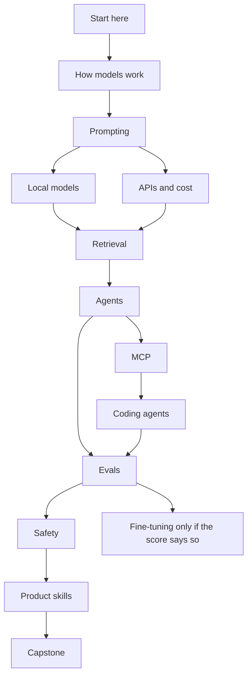

<p align="center">
  
</p>

# AI Lab Free University

A free offline course for people who want to build with models and be able to show their work. It covers how models behave, prompting, local and hosted APIs, retrieval, agents, the Model Context Protocol (MCP), coding agents, evals, fine-tuning, safety, and the product skills behind a shippable feature.

One HTML file. No account. No API key required to read it. No remote fonts, scripts, or images.

**Free to use, share and remix.** MIT license. No warranty.

<p align="center">
  <a href="zips/v2-UNIVERSITY.html.zip"><strong>Download the campus (.zip)</strong></a>
  &nbsp;&nbsp;·&nbsp;&nbsp;
  <a href="university/v2-UNIVERSITY.html"><strong>Open the HTML</strong></a>
</p>

Direct download from GitHub: [v2-UNIVERSITY.html.zip](https://github.com/cipher0x9/ai-lab-free-university-mesmerizing/raw/main/zips/v2-UNIVERSITY.html.zip)

---

## What you get

| | |
|---|---|
| Course | `university/v2-UNIVERSITY.html` — 14 tracks, 128 lessons, about 19 hours of reading |
| File | One page. Progress stays in your browser. Works offline after you open it. |
| Proof | Every practice asks for a run, a trace, a metric, and an artifact |
| Updated | October 2026. Pin the model id you call; names move. |


---

## What you'll learn

| Track | Lessons | You will be able to |
|---|---:|---|
| Start here | 6 | Use the course, keep proof, and apply the safety rules |
| How models work | 8 | Explain tokens, context, sampling, hallucination, and 2026 model roles |
| Prompting | 7 | Write a job, an output shape, and a test for the next change |
| Local models | 7 | Run an open-weight model that fits your machine, and keep data apart from weights |
| APIs and cost | 6 | Call a hosted model without leaking the key, and read the bill |
| Retrieval | 7 | Cite a real passage, and measure whether retrieval found it |
| Agents | 7 | Design a tool loop with a schema, a step cap, and a trace |
| MCP | 6 | Connect a tool server without granting it silent access |
| Coding agents | 6 | Review a repository edit against the diff and the tests |
| Evals | 7 | Gate a change on quality, safety, latency, and cost |
| Fine-tuning | 5 | Decide when LoRA is warranted, and compare it to the base model |
| Safety | 5 | Write a one-page policy for data, tools, and human approval |
| Product skills | 6 | Specify a feature a product manager and an engineer can measure |
| Capstone | 5 | Finish a small grounded assistant on notes you are allowed to use |

Glossary, interview practice, and course questions sit beside the tracks.

## Learning path



Four shorter routes are on the home page: new to AI, a grounded assistant, coding-agent work, and product judgment.

---

## How to use it

1. Download [v2-UNIVERSITY.html.zip](zips/v2-UNIVERSITY.html.zip).
2. Unzip it.
3. Open `v2-UNIVERSITY.html` in Chrome, Safari, Edge, or Firefox. Use the full browser app. In-app browsers often block a local file.
4. On iPhone: download the file, then open it from Files in Chrome or Safari.

Study a lesson, do the practice, then use **Next**. **Mark complete** stores progress only in that browser. Search is in the sidebar. The sun and moon button switches the light and dark themes. `/` focuses search. `[` and `]` move between lessons.

A desktop browser is the most comfortable. A phone is enough to read.

You do not need a GPU or an API key to study. Add a local model or a hosted key only when a practice asks for a live call, and only with data you are allowed to send.

More detail: [START-HERE.md](START-HERE.md) · [HOW-TO-GET.md](HOW-TO-GET.md) · [DOWNLOADS.md](DOWNLOADS.md) · [docs/FAQ.md](docs/FAQ.md)

## Remix

The campus is generated so the lessons stay reviewable:

```bash
git clone https://github.com/cipher0x9/ai-lab-free-university-mesmerizing.git
cd ai-lab-free-university-mesmerizing
python3 -m campus.build_campus
```

That rewrites `university/v2-UNIVERSITY.html` and `docs/assets/hero.svg`. Lesson text lives in `campus/`. The built file is what you open and what the zip contains.

You may copy, change, and redistribute the course under the [MIT license](LICENSE). Keep the copyright notice. Do not present model weights, vendor docs, or someone else's data as part of this license. If you publish a remix, say what you changed, and do not add a CDN dependency to the HTML file.

To rebuild the zip from your copy:

```bash
python3 -m campus.build_campus
python3 -c "import zipfile; zipfile.ZipFile('zips/v2-UNIVERSITY.html.zip','w',compression=zipfile.ZIP_DEFLATED).write('university/v2-UNIVERSITY.html','v2-UNIVERSITY.html')"
```

`university/v1-SLICE.html` is an older short page. The course is v2.

## FAQ

**Is this free?**  
Yes. Free to use, share and remix under MIT. There is no account and no certificate. The capstone folder is the evidence.

**Does the page phone home?**  
No. It does not load remote assets. Progress is local storage in your browser.

**Which model should I install?**  
A small instruct model whose license you have read, in a size that fits your memory. The course teaches the decision. It does not crown a vendor.

**Can I use it at work?**  
You can use the text. Your employer's data rules and the model license still apply. Do not paste secrets or customer data into a hosted model because a lesson mentioned an API.

**How do I report a mistake?**  
Open an issue with the lesson id (for example `07-05`), the sentence, and the correction. Specs and model names move. A dated source helps.

## Related

Voice and contact-center material lives in a separate course, [UC Lab Free University](https://github.com/cipher0x9/uc-lab-free-university-mesmerizing). This campus does not try to be that course.

## Author

**CYPHER0X9** · [cipher0x9](https://github.com/cipher0x9)

Educational material. No warranty. Lab safely, and do not upload secrets.
